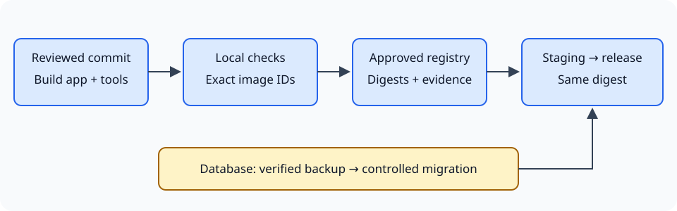

# Docker Mastery

**Learn Docker by building, debugging, securing, and recovering a real application.**

A free-to-read, hands-on learning guide with **20 lessons**, runnable labs, and a
Next.js + PostgreSQL task tracker. Start with your first container and progress
through Compose, database recovery, secure builds, and controlled delivery.

[](https://docs.docker.com/)
[](#learning-path)
[](#choose-your-orm-track)

[Get started](#quick-start) · [Learning path](#learning-path) · [Runnable labs](#runnable-labs) · [Validation](#testing-and-validation) · [Safety](#safety-and-scope)

[Operations runbook](docs/OPERATIONS-RUNBOOK.md) · [Completion checklist](docs/COMPLETION-CHECKLIST.md)

## Why this guide?

- **Learn by doing:** run containers, build images, trace requests, and diagnose failures.
- **Understand the commands:** explanations cover flags, file paths, expected results, and cleanup.
- **Build something real:** a task tracker with migrations, seeds, health endpoints, and persistent data.
- **Choose either ORM:** Prisma and Drizzle have separate, equivalent implementations.
- **Practice recovery:** verify database restoration and recover a deliberately failed migration.
- **Go beyond a Dockerfile:** explore BuildKit, non-root runtimes, resource limits, registries, CI, and rollback.
- **Read comfortably:** responsive navigation, search, dark/light themes, copyable code, and local diagrams.
- **Learn without an account:** no sign-in, cloud subscription, or cluster tooling required.

Light ninja-team storytelling adds context, but the technical explanations stand
on their own. Optional AI exercises supplement a complete manual learning path.

## Quick start

You only need **Node.js 24** to preview the documentation. The guide itself has
no npm dependencies, and Docker is not required just to read it.

```bash
git clone https://github.com/kharalnirmal/docker-mastery.git
cd docker-mastery
npm start
```

Open **http://127.0.0.1:4173**. Stop the preview with **Ctrl+C**.

The preview binds to loopback and blocks environment files, dependencies, and
backup artifacts. Use the preview server rather than opening `index.html`
directly. Hash-based lesson URLs support bookmarks and browser back/forward.

### To run the Docker labs

- A working **Linux Docker engine** and modern `docker compose`.
- **Windows:** Docker Desktop with WSL2 integration; use WSL Bash for lesson commands.
- **macOS/Linux:** follow the setup notes in the first lesson and official installation docs.
- **8 GB RAM** is the planning target; run one application track at a time.
- Internet access for initial image and dependency downloads.

Check Docker Desktop licensing for your organization. Local runtime evidence is
Windows-client/Linux-AMD64; it is not certification for every OS or architecture.

## Learning path

| Stage | Lessons | What you will practice |
| --- | --- | --- |
| Foundations | 1–2 | First container, images, processes, ports, and container lifecycle |
| Build and connect | 3–5 | Dockerfile instructions, build context, private networks, and durable volumes |
| Diagnose and recall | 6–7 | Troubleshooting and a task-oriented command reference |
| Build the application | 8–11 | Next.js + PostgreSQL, Prisma or Drizzle, and Compose workflows |
| Recover and migrate | 12–14 | Logical backups, verified restoration, compatible upgrades, and failure recovery |
| Secure and deliver | 15–19 | BuildKit, runtime hardening, registries, CI, and single-host releases |
| Capstone | 20 | Complete the developer loop and hand off an operational runbook |

Progress at your own pace. Experienced developers can use lesson prerequisites
and checkpoints to jump to the area they need.

New to the terminal? Begin with the [Bash, paths and networking primer](index.html#first-container/terminal-basics).
For terminology, use the [searchable command-reference glossary](index.html#command-reference/glossary).
Finish by filling in the [operations/incident runbook](docs/OPERATIONS-RUNBOOK.md)
and your own [completion checklist](docs/COMPLETION-CHECKLIST.md). The checklist
clearly separates this complete local course from optional public-production gates.

## Choose your ORM track

The task tracker lets you create, list, assign, and complete tasks using demo
members. Both tracks implement the same application behavior and database model.

| Track | Implementation |
| --- | --- |
| **Prisma** | [`examples/compose/prisma`](examples/compose/prisma) |
| **Drizzle** | [`examples/compose/drizzle`](examples/compose/drizzle) |

**Choose one track per project.** Do not apply both migration histories to the
same database. Start with the [application and Compose instructions](examples/compose/README.md).

## Runnable labs

| Checkpoint | Files and instructions |
| --- | --- |
| First image | [`examples/docker/01-static-page`](examples/docker/01-static-page) |
| Application + Compose | [`examples/compose/README.md`](examples/compose/README.md) |
| PostgreSQL backup and schema expansion | [`examples/recovery/README.md`](examples/recovery/README.md) |
| Failure recovery, hardening, CI, and releases | [`examples/delivery/README.md`](examples/delivery/README.md) |



The GitHub Actions/GHCR workflow is an **optional template**, not an automatically
enabled release pipeline. Read its approval, permissions, and repository setup
instructions before copying it into `.github/workflows/`.

## Project structure

```text
docker-mastery/
├── index.html             # Static learning guide
├── assets/                # Lessons, styles, fonts, and original illustrations
├── docs/                  # Operations/incident runbook and completion checklist
├── examples/
│   ├── docker/            # Small image-building checkpoint
│   ├── compose/           # Independent Prisma and Drizzle applications
│   ├── recovery/          # Database recovery and migration overlays
│   └── delivery/          # Hardening, BuildKit, release files, and CI template
├── tests/                 # Structural, preview-server, and browser checks
├── tools/                 # Local preview and disposable lab verification
├── CONTENT-REVIEW.md       # Dated evidence, source review, and limitations
└── LAB-VALIDATION.md       # Detailed verification commands and safety boundaries
```

## Testing and validation

Run the dependency-free structural and preview-server tests:

```bash
npm test
```

From a Git checkout, create the dependency-free static release with `npm run build`. Upload the contents
of `dist/` to a static host. The export includes the guide and downloadable lab
sources, but excludes Git metadata, local secrets, database archives, dependencies,
test evidence, and full-size artwork. The exporter uses Git's tracked-file list;
stage new public files before building. No hosting or publishing workflow is enabled
automatically. Rerun the build after editing source files. A read-only GitHub Actions
workflow runs the Node tests and static build on pushes and pull requests.

Recorded local verification includes:

- **16 passing Node tests** covering content, links, file parity, documentation handoffs, artwork budgets, safe exports, and preview restrictions.
- Browser checks across **seven viewport sizes**, all 20 lessons at mobile width,
  keyboard navigation, search, themes, and trusted emulated touch.
- Container/image/network/volume checks and BuildKit secret/cache boundaries.
- Independent Prisma and Drizzle builds, migrations, API behavior, persistence,
  database restore, failed-migration recovery, and hardened-runtime checks.

Read [CONTENT-REVIEW.md](CONTENT-REVIEW.md) for dated results and limitations, and
[LAB-VALIDATION.md](LAB-VALIDATION.md) for reproduction commands. Browser checks
require a separately installed `agent-browser` and a running preview.
Run `node tests/browser-accessibility.cjs` for light/dark axe scans, reduced-motion
checks, and a 200% CSS-zoom reachability stress test. These automated checks do not
replace screen-reader, physical-device, or manual browser/text-zoom review.

**Runtime verification changes Docker state.** The scripts create uniquely named
disposable resources and delete their own test data during cleanup. Local
checkers deliberately restrict the Docker context. Inspect the scripts and the
runbooks before executing them; do not repoint them at production.

## Safety and scope

- This is an **educational project**, not a production-security certification.
- The task tracker has **no authentication or authorization**. Keep it local and use demo data.
- Local ports bind to loopback; the base application stack does not publish PostgreSQL.
- Database volumes are not backups. Verify restoration before trusting a backup strategy.
- Deleting volumes destroys data. No global prune is required for the lessons.
- Never commit `.env` files, credentials, database dumps, or private customer data.
- Live GHCR publishing, public hosting/TLS, signed supply-chain evidence, and
  independent-host recovery require separate setup and authorization.

## Contributing

Corrections, clearer explanations, and reproducible lab fixes are welcome.

1. Open an issue describing the problem, OS/shell, relevant versions, and sanitized steps.
2. Keep changes focused and explain command flags, verification, and safe cleanup.
3. Run `npm test`; for lab changes, test the affected track and document actual results.
4. Do not include secrets, dumps, personal data, or artwork without redistribution rights.

Please distinguish observed test results from expected or unexecuted behavior.

## Credits and usage

Created by **[Nirmal Kharal](https://github.com/kharalnirmal)**.

Inter and JetBrains Mono are self-hosted with their bundled SIL Open Font
Licenses in [`assets/fonts`](assets/fonts). Technical diagrams are original SVGs.
Onboarding uses optimized, owner-supplied Naruto, Sakura, and Sasuke artwork;
third-party redistribution rights remain unverified. See [NOTICE.md](NOTICE.md).

Free to read does not imply an unrestricted software/content license. No blanket
license is granted for the repository; third-party font licenses apply to their
respective files. Contact the author for reuse permission.
